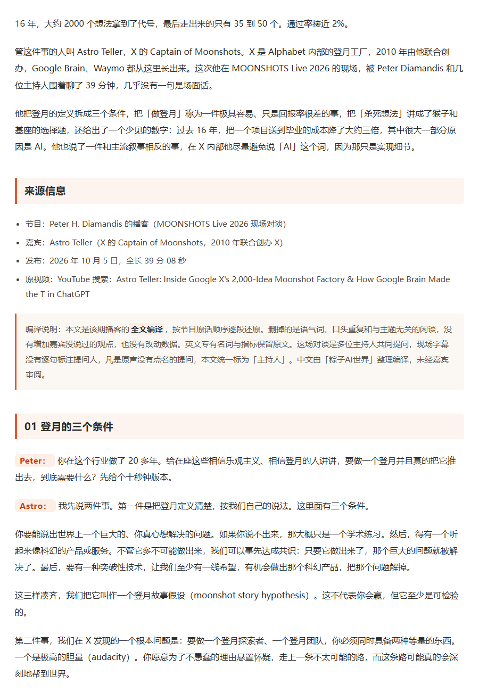

# podcast-to-wechat

把英文播客访谈变成中文公众号长文的 Codex skill。

一条「选题 → 成稿 → 出图 → 排版 → 切片 → 推草稿」的流水线：从 YouTube 上找访谈播客，抓完整逐字稿，编译成中文全文实录体对谈稿，过去 AI 味机检，排成公众号可直接粘贴的 HTML，配上插画、贴图封面和金句卡，写出演播稿与视频切片，最后推进公众号草稿箱。

## 九环节

| # | 环节 | 做什么 |
| --- | --- | --- |
| 0 | 选题 | 搜最近 7 天 AI 赚钱 / 产品 / 创业 / 投资 / 认知 / 营销方向的访谈播客，按嘉宾权威性、观点密度、钩子强度筛 1 篇 |
| 0.5 | 去重 | 读已发布清单，排除做过的 `video_id` |
| ① | 抓字幕 | TikHub 取完整逐字稿 + 视频元信息 |
| ② | 写文章 | 全文实录体：叙事钩子 →「主要观点」≤5 条 → 分节逐轮问答 → 结尾判断 |
| ②.5 | 去 AI 味 + 终检 | 破折号 0 处、碎片回合 0 处、正文 0 图、首尾编译说明、来源四项、字数 ≥逐字稿 1/3 |
| ③ | 排版 | Markdown → 内联样式 HTML，公众号可直接粘贴 |
| ④ | 标题 / 摘要 | `深度｜对话{机构/人物}：{观点}？`，约束标题与摘要长度 |
| ⑤ | 出图 | 插画（竖版 / 方版）+ 横版封面 + 贴图 3x4 / 1x1 + 金句卡 |
| ⑥ | 口播稿 | 3–4 分钟讲稿，带停顿与重音提示 |
| ⑦ | 切片 | 3–5 条 9:16 竖版短片的标题、口播词、字幕要点 |
| ⑧ | 推草稿箱 | 上传封面 + `draft/add`，只进草稿不群发 |

另外带两个编排脚本：`run-automation.ps1` 跑完整一轮（含无人值守调度），`run-rebuild.ps1` 按队列批量重做存量。

## 示例

四篇已发布成品。点图进目录，每个目录里有成品 HTML、封面原图和正文首屏截图。

| | |
| --- | --- |
| [](examples/published/01_2026-10-11_深度-对话大空头原型-AI-泡沫会怎么破/) | [](examples/published/02_2026-10-11_深度-对话-Crusoe-CEO-AI-基建的护城河是幻觉/) |
| [](examples/published/03_2026-10-08_深度-对话-Google-X-2000-个想法-只毕业-2/) | [](examples/published/04_2026-10-08_深度-对话-OpenAI-Agent-为什么要「有身份」/) |

正文排版效果（以《对话 Google X》为例，完整首屏见 [examples/published/README.md](examples/published/README.md)）：



因为发布后的文章仍留在公众号草稿箱里，这份示例可以随时重新同步：

```bash
node tools/sync-published-examples.mjs --limit 4   # 同步最新 4 篇
node tools/sync-published-examples.mjs --dry-run   # 只预览，不落盘
```

## 安装

```bash
git clone https://github.com/jeasonholders089-cell/podcast-to-wechat.git \
  ~/.codex/skills/podcast-to-wechat
```

Windows：

```powershell
git clone https://github.com/jeasonholders089-cell/podcast-to-wechat.git "$env:USERPROFILE\.codex\skills\podcast-to-wechat"
```

目录名要保持 `podcast-to-wechat`，与 `SKILL.md` 里的 `name` 一致。

## 依赖

| 组件 | 用途 |
| --- | --- |
| Node.js 18+ | 所有 `.mjs` 脚本（依赖全局 `fetch` / `FormData`） |
| Python 3 + Pillow | `check_art_faces.py` 人脸废图机检 |
| Chrome 或 Edge | `make_social_cover.mjs` 无头截图出图 |
| Codex CLI | 跑批时用 `codex exec` 驱动创作半程 |

## 凭证

脚本按顺序读 `D:\内容生产\.env` → `D:\项目\AI内容生产\.env`（后者优先），也认环境变量：

| 变量 | 用途 |
| --- | --- |
| `TIKHUB_API_KEY` / `TIKHUB_BASE_URL` | 选题搜索、抓字幕 |
| `AI98_生图_API_Key`（或 `AI98_API_KEY`）/ `AI98_BaseUrl` | 生成插画 |
| `WECHAT_APPID` / `WECHAT_SECRET`（或 `WECHAT_APPSECRET`） | 推送草稿箱 |

微信公众号需要在后台「设置与开发 → 基本配置 → IP 白名单」里放行本机出口 IP，否则取 `access_token` 会直接失败（`errcode 40164`）。

## 目录

```
SKILL.md                          总纲：九环节、脚本用法、硬门槛、凭证、编排
references/
  pipeline.md                     环节细节规范
  anti-ai-rules.md                反 AI 腔规则
  humanize-guide.md               人味化写法
assets/
  voice-dna.md                    品牌声纹（示例骨架，按需替换）
  social-art-prompt.md            插画提示词模板
  prompts/                        给 codex exec 的指令提示词
templates/
  podcast-interview/template.json 排版模板
scripts/                          11 个脚本：引擎 + 编排
tools/
  sync-published-examples.mjs     从公众号草稿箱同步已发布成品作为示例
examples/
  published/                      已发布成品示例（文章.html + 封面 + 索引）
```

## 直接用

```bash
# 选题
node scripts/search_videos.mjs --query "AI founder interview,20VC interview" --limit 12 --enrich 8

# 抓逐字稿
node scripts/fetch_transcript.mjs --video <video_id 或 URL> --out-dir <期目录>

# 去 AI 味 + 结构终检（硬门槛，退出码非 0 即 FAIL）
node scripts/check_ai_flavor.mjs --md <文章.md> --transcript <逐字稿.txt>

# 排版
node scripts/render_article.mjs --in <文章.md> --out <文章.html> --template podcast-interview

# 出图
node scripts/generate_art.mjs --name <slug> --out-dir <期目录> --subject "…"
node scripts/make_social_cover.mjs --name <slug> --title "第一行|第二行" --out-dir <期目录> --sizes h,3x4,1x1,quote
python scripts/check_art_faces.py <期目录>

# 推草稿箱
node scripts/push_to_wechat_draft.mjs --check
node scripts/push_to_wechat_draft.mjs --html <文章.html> --title "…" --digest "…" --cover <横版封面.png> --dry-run
```

## 可移植性说明

- 默认路径面向 Windows 单机作业环境（产线根目录 `D:\项目\AI内容生产`）。换机器时用 `-Root` 参数或环境变量覆盖，脚本不会硬写死。
- 品牌色（纸面 `#F5F1E9` / 朱红橙 `#E8552D` / 炭黑 `#2B2B2B`）写在 `templates/podcast-interview/template.json` 和 `scripts/make_social_cover.mjs` 里；换号改这两处。
- `assets/voice-dna.md` 是声纹骨架，建议换成自己的样本与偏好。
