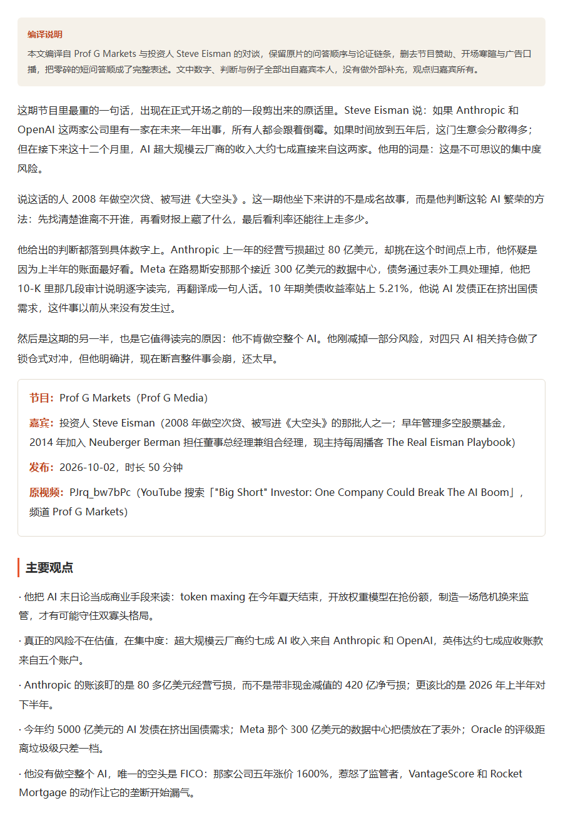
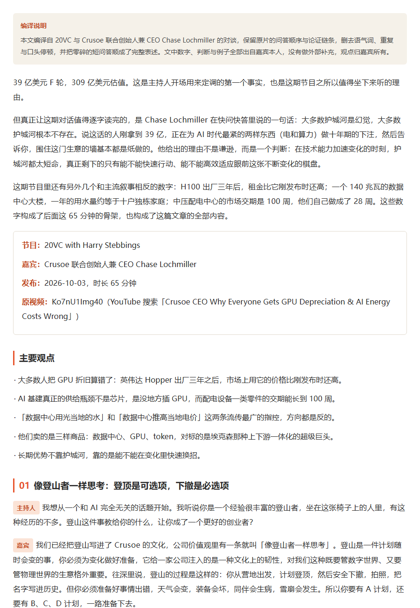
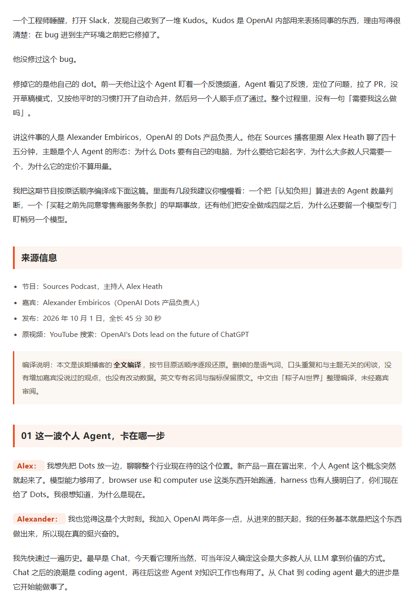

# 已发布成品示例

从公众号同步下来的真实排版成品。每篇一个目录，含：

- `文章.html` —— 发布时的排版成品（内联样式，公众号编辑器可直接粘贴的那一版）
- `封面.jpg` —— 对应的 1280×544 公众号封面
- `预览.png` —— 正文首屏截图，用来直观看到排版效果
- `meta.json` —— 标题、日期、media_id

同步脚本：`node tools/sync-published-examples.mjs --limit 4`（`--dry-run` 只预览，`--no-preview` 跳过截图）

## 深度｜对话大空头原型：AI 泡沫会怎么破？

2026-10-11 · [成品 HTML](01_2026-10-11_深度-对话大空头原型-AI-泡沫会怎么破/文章.html)

## 深度｜对话 Crusoe CEO：AI 基建的护城河是幻觉？

2026-10-11 · [成品 HTML](02_2026-10-11_深度-对话-Crusoe-CEO-AI-基建的护城河是幻觉/文章.html)

## 深度｜对话 Google X：2000 个想法，只毕业 2%

2026-10-08 · [成品 HTML](03_2026-10-08_深度-对话-Google-X-2000-个想法-只毕业-2/文章.html)

## 深度｜对话 OpenAI：Agent 为什么要「有身份」

2026-10-08 · [成品 HTML](04_2026-10-08_深度-对话-OpenAI-Agent-为什么要「有身份」/文章.html)

